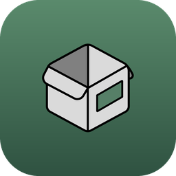
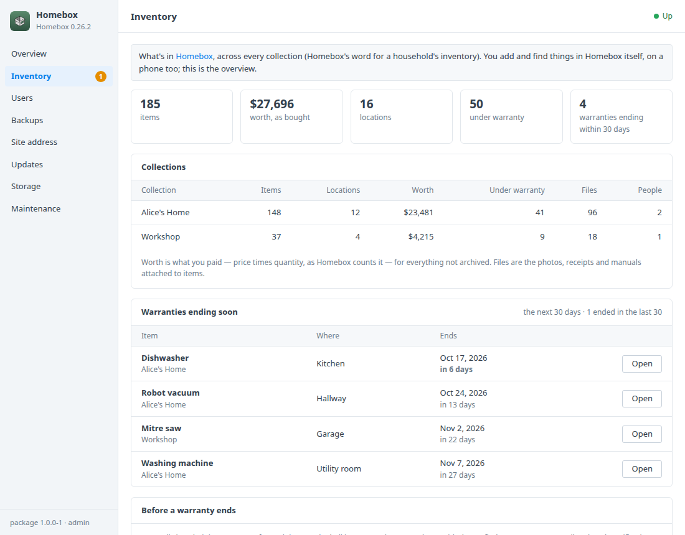
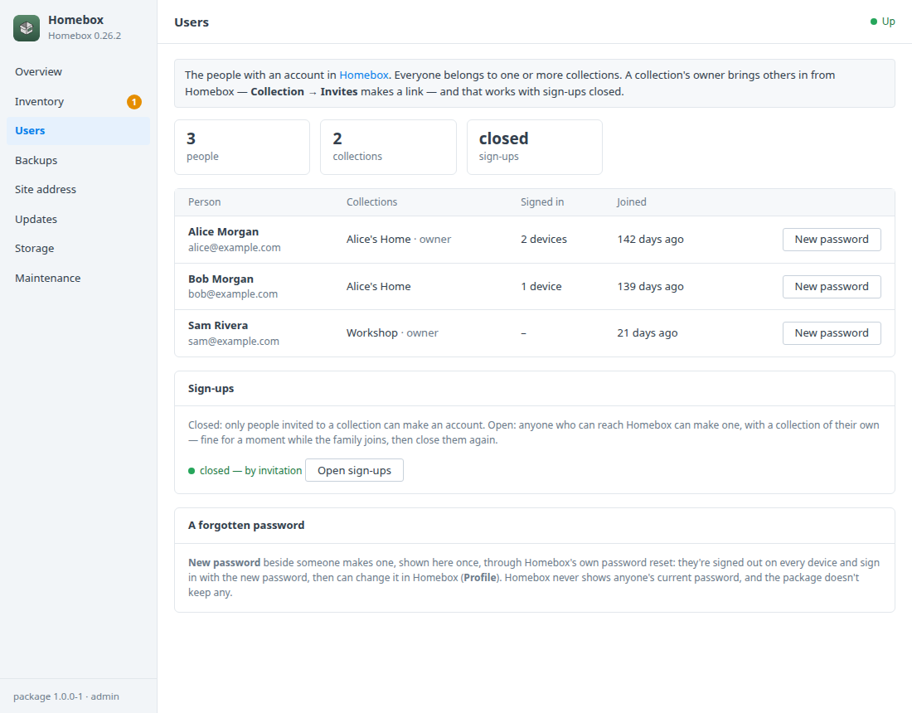
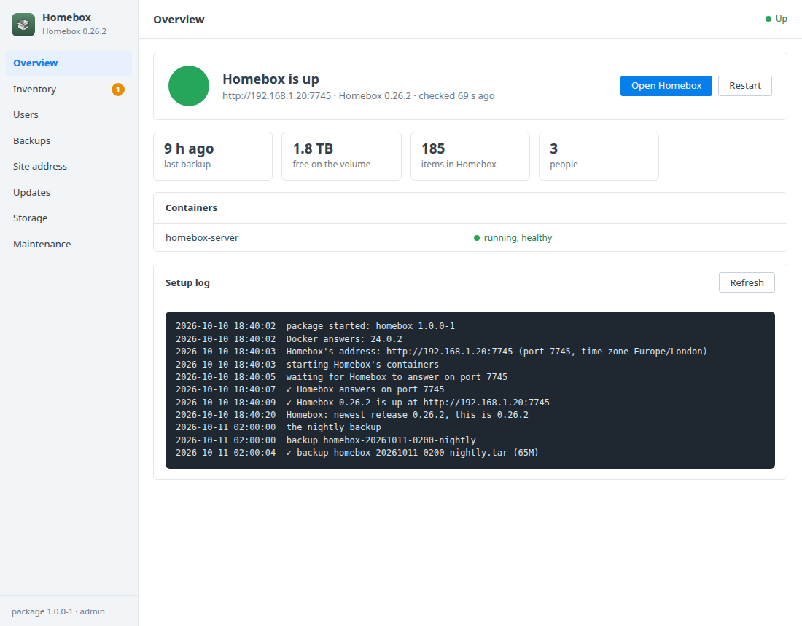
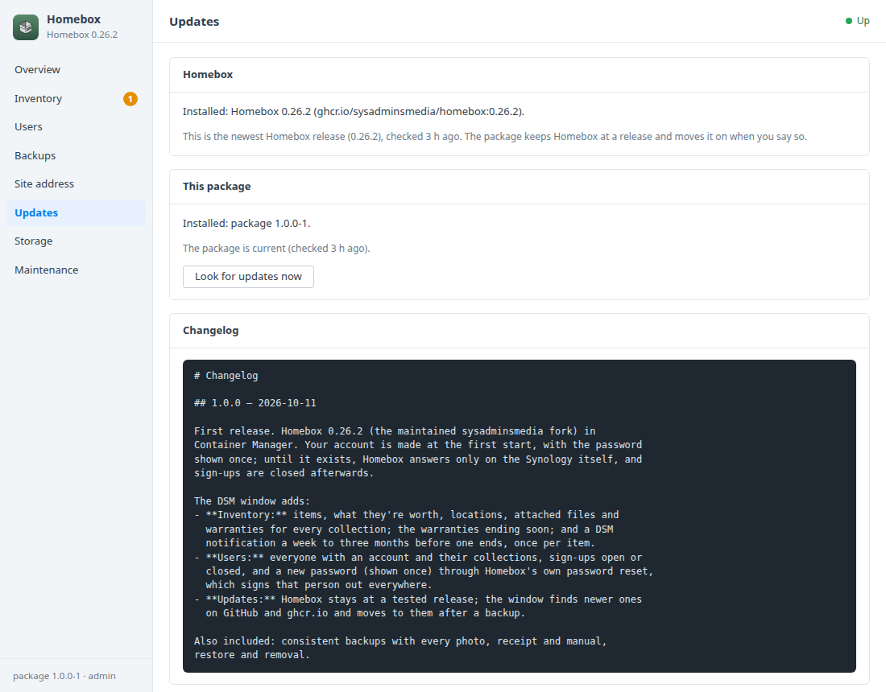

# Homebox for Synology DSM

A DSM 7 package that installs [Homebox](https://homebox.software) in Container
Manager. Homebox is a home inventory: what you own, where it is, what it cost,
the receipts, manuals and photos that go with it, and when each warranty ends.
A DSM window looks after:
- your account, made at the first start;
- who else may use it;
- what your things are worth;
- a warning before a warranty ends;
- backups and updates.

Built on the [DSM app chassis](https://github.com/tombruton87/dsm-app-chassis).

## Download

### **[⬇ Download homebox.spk](https://github.com/tombruton87/homebox-dsm/releases/latest/download/homebox.spk)**

[](https://github.com/tombruton87/homebox-dsm/releases/latest)

That link always gives the newest version. Older ones are on the
[Releases](https://github.com/tombruton87/homebox-dsm/releases) page.

Install: Package Center → Manual Install → the `.spk` (DSM 7.2.1+; Container
Manager is installed first if missing). The wizard asks for the NAS's address,
a port (7745 by default), a time zone, and your name and email. Your account is
made at the first start and its password is shown once in the window.

**Which Homebox.** The original Homebox (`hay-kot/homebox`) is archived on
GitHub (read-only since 2024) and gets no more fixes. This package runs the
maintained fork, [sysadminsmedia/homebox](https://github.com/sysadminsmedia/homebox)
(`ghcr.io/sysadminsmedia/homebox`), pinned to a release it was tested with.

**Sign-ups are closed.** Until your account exists, Homebox answers only on the
Synology itself, so nobody else on the network can sign up first. After that,
the people you live with join through an invitation to your collection
(in Homebox: **Collection → Invites**), or you open sign-ups for a moment in
the window.

## What the DSM window adds

- **Inventory**
  - Items, what they're worth (price × quantity, as Homebox counts it),
    locations, attached files and warranties, for every collection.
  - The warranties ending in the coming weeks, with a link to each item.
  - **Before a warranty ends:** a DSM notification a week, two weeks, a month,
    two or three months ahead, once per item, so there's time to claim a repair
    while it's covered.
- **Users**
  - Everyone with an account, their collections, and how many devices they're
    signed in on.
  - **Sign-ups** open or closed.
  - **New password** for anyone (shown once). It goes through Homebox's own
    password reset, which also signs that person out on every device.
- **Updates** — Homebox stays at a tested release. The window looks for newer
  releases on GitHub and ghcr.io, and moves to one when you press Update, after
  a backup.
- **Site address, backups, storage, maintenance** — the address, and HTTPS
  through DSM's reverse proxy. Backups hold a checked copy of Homebox's SQLite
  database and every photo, receipt and manual; they're made nightly or on
  demand, with restore. You can also:
  - make a redacted support report;
  - read the logs;
  - remove Homebox and everything with it.

## Screenshots

| | |
|---|---|
|  |  |
|  |  |

## How it works

Homebox runs as one container. Its SQLite database and every attached file
live in the `homebox_data` volume.

Homebox has no admin API, so the package uses Homebox's own front doors:
- Your account is made through its sign-up endpoint at the first start. While
  that happens, Homebox's port is bound to 127.0.0.1 only.
- A new password goes through Homebox's own recovery path for installs without
  email. Its `reset-password` command runs inside the container and mints a
  one-time token.
  Homebox's reset endpoint then sets the password and ends the person's
  sessions. The token never reaches a log.
- The window's numbers are read from Homebox's database, read-only. The queries
  follow the ones Homebox uses for its own statistics.

The package keeps no passwords.

The image comes from ghcr.io, which the chassis's Docker Hub update check can't
read. The package therefore looks for Homebox releases itself, and moves the
pin only when you ask. A newer package that brings a newer tested Homebox moves
it forward on start, after a backup.

## Layout

```
chassis/          the DSM app chassis (git submodule)
package.conf      name, title, services, volumes, images, port, texts
app/compose.yaml  Homebox
setup/app.sh      the hooks: your account, sign-ups, passwords, warranties, updates, backups
ui/               Inventory and Users tabs, Homebox's Updates card; CGI validation
wizard/           the Homebox page of the install wizard (your name and email)
tests/            steps for the chassis harness (a household inventory made through Homebox's API)
```

Test: `chassis/tests/e2e.sh . up && chassis/tests/e2e.sh . act` on any Linux
box with Docker.

Release: bump `VERSION`, add the changes to `CHANGELOG.md`, build, then attach
the package twice, under its versioned name and as `homebox.spk`:

```bash
cp dist/homebox-X.Y.Z-1.spk /tmp/homebox.spk
gh release create vX.Y.Z dist/homebox-X.Y.Z-1.spk /tmp/homebox.spk
```

Build: `chassis/build.sh . N`.

## Credits

The icon is Homebox's own box mark on a DSM-style tile in the green of its
label. Homebox is AGPL-3.0 software, originally by Hayden (hay-kot) and now
maintained by the sysadminsmedia team and contributors. This package is not
affiliated with Homebox, sysadminsmedia or Synology.
